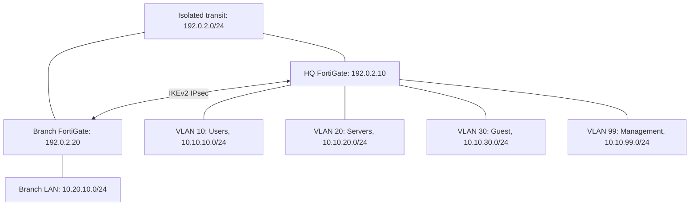

# FortiGate Security Lab

[](https://github.com/jaidosajh/fortigate-security-lab/actions/workflows/lab-checks.yml)

A reproducible network security portfolio by **Jai Dosajh**, focused on the work of a Systems Administrator and Cybersecurity Analyst: segmentation, least-privilege firewall rules, VPN design, configuration review, and incident triage.

## What you can run today

The Python tools work offline with synthetic data, require Python 3.10+, and use only the standard library. No firewall credentials or appliance are required.

```bash
git clone https://github.com/jaidosajh/fortigate-security-lab.git
cd fortigate-security-lab
python3 -m unittest discover -s tests -v
python3 tools/policy_audit.py configs/hq-policies.conf
python3 tools/policy_audit.py samples/risky-policies.conf --fail-on-findings
python3 tools/log_triage.py samples/traffic.log --threshold 3
```

The risky sample deliberately exits **1** with findings. Valid clean input exits **0**; malformed or unsupported input exits **2**. See [tool scope](docs/tool-scope.md) before reviewing real exports.

## Lab architecture



| Capability | Included artifact |
| --- | --- |
| VLAN segmentation and interface isolation | [HQ interfaces](configs/hq-interfaces.conf), [build guide](docs/lab-build.md) |
| Ordered policies, outbound NAT, guest isolation | [HQ policy configuration](configs/hq-policies.conf), [traffic matrix](docs/traffic-matrix.md) |
| Two-site route-based VPN design | [HQ template](configs/hq-vpn.conf.template), [branch template](configs/branch-vpn.conf.template) |
| Security automation | [Policy auditor](tools/policy_audit.py), [log triage](tools/log_triage.py) |
| Incident response and validation | [Triage runbook](docs/incident-response.md), [validation plan](docs/validation.md) |

## Evidence and scope

This repository contains original lab templates, synthetic log examples, and automated Python tests. **The FortiOS configurations have not been deployed or tested on a live FortiGate.** They are based on the FortiOS 7.4 CLI documentation, matching my FortiGate 7.4 Administrator background; this is a syntax reference, not a recommendation to install a particular firmware release.

The auditor performs limited checks on explicit policy settings. It does not resolve address groups, simulate traffic, inspect device-local access, or prove that a firewall is secure. The log tool counts denied sessions per source across one input file; it does not detect a scan or attack by itself.

No customer configurations, real incident data, public WAN assignments, or working secrets are included. VPN templates require a locally generated pre-shared key. Live lab evidence can be recorded using [the evidence template](docs/evidence-template.md), without claiming results before measurement.

## Getting started with FortiGate

Follow [the build guide](docs/lab-build.md) with two licensed FortiGate VMs, a VLAN-capable isolated switch or virtual bridge, and test endpoints. Review [the traffic matrix](docs/traffic-matrix.md), then run [the validation plan](docs/validation.md). Physical or virtual interface mappings vary by model.

Related project: [SysAdmin Security Toolkit](https://github.com/jaidosajh/sysadmin-security-toolkit).

[Official references](docs/references.md) · [Contributing](CONTRIBUTING.md) · [MIT license](LICENSE)
